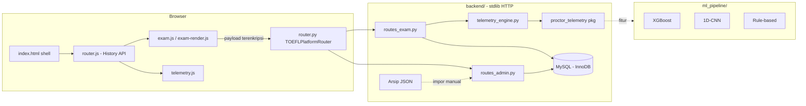

<div align="center">


# LinguaPulse TOEFL EPT


**Platform simulasi TOEFL EPT dengan pengawasan integritas berbasis machine learning.**

Listening · Structure · Reading — plus telemetri perilaku (keystroke dynamics, fokus, pointer) yang dinilai model XGBoost dan 1D-CNN untuk riset integritas pengerjaan.

[Fitur](#-fitur-unggulan) · [Mulai Cepat](#-mulai-cepat) · [Arsitektur](#-arsitektur) · [API](#-ringkasan-api) · [Struktur Proyek](#-struktur-proyek) · [Pengujian](#-pengujian) · [Sitasi](#-sitasi-akademik) · [Lisensi](#-lisensi)

</div>

---

## Tentang Proyek

LinguaPulse adalah aplikasi web lengkap untuk latihan TOEFL EPT sekaligus instrumen riset: setiap sesi ujian merekam pola perilaku peserta secara **lokal dan privasi-sadar** — tanpa menyimpan isi ketikan mentah atau isi clipboard — lalu mengekstraknya menjadi fitur terukur (median dwell time, rasio backspace, entropi spasial pointer, episode kehilangan fokus) untuk diklasifikasikan oleh model integritas pengerjaan.

> Hasil latihan bukan skor atau sertifikat TOEFL resmi.

| | |
|---|---|
| **Backend** | Python standard library murni — `http.server`, `sqlite3`, tanpa framework |
| **Frontend** | SPA Vanilla JavaScript, tanpa bundler; font dimuat dari Google Fonts |
| **Database** | MySQL 8, InnoDB, utf8mb4; migrasi SQLite baca-saja tersedia |
| **Bank Soal** | MySQL; JSON digunakan untuk arsip serta impor/ekspor manual |
| **ML Pipeline** | XGBoost, 1D-CNN, dan baseline rule-based — via paket terpisah [`proctor_telemetry`](https://github.com/firdausmntp/proctor_telemetry) (lokal: `packages/`, diabaikan git) + `ml_pipeline/` |
| **Tema Visual** | *Cobalt Modern* — CSS tokens terpusat, tanpa emoji pada UI |

## Fitur Unggulan

### Ruang Ujian
- **Paket EPT utuh** — Listening (audio sintetis lokal), Structure, dan Reading dalam satu sesi dengan durasi yang diatur pengawas (bawaan 25 menit).
- **Snapshot bank soal per sesi** — `/api/exam/start` membekukan salinan soal ke database, sehingga pengeditan admin tidak pernah mengubah penilaian sesi yang sedang berjalan.
- **Draf tahan kegagalan** — jawaban, bagian aktif, dan sisa waktu tersimpan di perangkat; refresh tidak mengulang timer; kirim ulang otomatis terlindungi ID percobaan anti-duplikasi.
- **Auto-submit saat waktu habis** dengan jaring penyelamat: jika pengiriman gagal, draf tetap aman untuk dicoba kembali.
- **Latihan bebas** (`/practice`) — soal acak, pembahasan langsung, tanpa timer, tanpa rekaman, tidak menyentuh riwayat ujian.

### Pengawasan Integritas (Proctoring)
- **Sensor tiga kanal** — keystroke dynamics (dwell/flight/interkey, backspace, paste), fokus & visibilitas (blur, tab hidden), dan pointer (heatmap ternormalisasi, entropi spasial antar zona passage/answer/navigation).
- **Aktif hanya saat ujian** — sensor pointer dan ketikan mati total di landing, login, dasbor, latihan, dan panel admin.
- **Muatan terenkripsi** — handshake kunci dan enkripsi paket telemetri (`security.js` ↔ `security.py`), verifikasi tantangan anti-bot, cookie sesi `HttpOnly`.
- **Inferensi ganda** — skor XGBoost, 1D-CNN, dan flag rule-based beserta ablation tersimpan terpisah dari hasil akademik.
- **Panel pengawas** — ringkasan operasional, detail sesi dengan timeline peristiwa dan heatmap, manajemen akun, CRUD bank soal dengan pratinjau peserta, impor/ekspor JSON, unggah audio hingga 8 MB.

### Privasi & Etika Riset
- Tidak ada karakter ketikan mentah, isi clipboard, atau data biometrik yang disimpan.
- Halaman `/privacy` dan `/terms` menjelaskan penggunaan data riset.

## Mulai Cepat

```bash
# 1. Masuk ke folder proyek
cd LinguaPulse

# 2. Pasang dependensi (Python 3.11+)
python -m pip install -r requirements.txt

# 3. Siapkan MySQL dan .env sesuai docs/mysql.md
# Pada komputer pengembangan ini, .env sudah tersedia; jangan ditimpa.
# Sesudah restart Windows: powershell -File scripts/start_mysql_local.ps1
python app.py

# 4. Buka browser
# http://localhost:8878 (server mendengarkan localhost secara default)
```

| Akun demo | Username | Sandi |
|---|---|---|
| Pengawas | `admin` | `admin123` |
| Peserta | `nadia_putri` | `student123` |

Petunjuk database baru, pemindahan SQLite, akun tes, dan backup: [docs/mysql.md](docs/mysql.md).

### Alur Peserta

```
/  landing  →  /register  →  /dashboard  →  /exam (persiapan + persetujuan)
      →  /exam/session (timer sesuai pengaturan, sensor aktif)  →  /results  →  /history
```

### Pemeriksaan Kualitas

```bash
python -m compileall -q backend questions      # sintaks Python
node --check frontend/js/exam/exam.js               # sintaks JavaScript (per berkas)
python tests/test_app.py                       # HTTP + headless browser (butuh playwright)
```

## Arsitektur



**Prinsip penting:**

1. **Snapshot per sesi** — bank soal aktif disalin ke `exam_attempts` saat sesi dimulai; resume dan penilaian memakai salinan yang sama.
2. **Pemisahan data** — hasil akademik (`exam_submissions`) dan telemetri (`telemetry_sessions`) berada di tabel berbeda sesuai batasan masalah penelitian.
3. **Kerangka modular** — `TOEFLPlatformRouter` mewarisi `AdminRoutes` + `ExamRoutes`; setiap berkas dibatasi maksimal 350 baris.

## Ringkasan API

| Endpoint | Method | Akses | Fungsi |
|---|---|---|---|
| `/api/auth/login` · `/api/auth/register` · `/api/auth/logout` | POST | Publik | Sesi akun, cookie `HttpOnly` |
| `/api/auth/me` | GET | Publik | Identitas sesi aktif |
| `/api/questions` | GET | Akun | Bank soal publik (admin melihat status aktif) |
| `/api/exam/settings` | GET | Akun | Durasi paket aktif |
| `/api/admin/exam-settings` | POST | Admin | Atur durasi sesi baru (1–240 menit) |
| `/api/exam/start` | POST | Peserta | Mulai sesi, bekukan bank, dapat `deadline` |
| `/api/exam/resume` | GET | Peserta | Lanjutkan sesi dari draf perangkat |
| `/api/submit` | POST | Peserta | Kirim jawaban + telemetri terenkripsi |
| `/api/practice/question` | GET/POST | Peserta | Latihan bebas dan pembahasan |
| `/api/history` · `/api/results?id=` | GET | Pemilik | Riwayat dan detail hasil |
| `/api/admin/overview` · `/api/proctor/sessions` | GET | Admin | Ringkasan dan detail pengawasan |
| `/api/admin/questions` (+`/import`, `/export`) | GET/POST/DELETE | Admin | CRUD, impor, ekspor bank soal |
| `/api/admin/audio` | POST | Admin | Unggah audio Listening ≤ 8 MB |
| `/api/admin/users` | GET/POST/DELETE | Admin | Manajemen akun |
| `/api/survey` | GET/POST | Akun | Kuesioner responden riset |

## Struktur Proyek

```
toefl/
├── app.py                      # Entry point: init schema, seed, serve
├── backend/                    # HTTP router + modul domain (semua < 350 baris)
│   ├── router.py               #   SPA routes, API, proteksi origin/CSRF
│   ├── routes_exam.py          #   Submit: penilaian + inferensi telemetri
│   ├── routes_admin.py         #   Handler pengawas
│   ├── attempts.py             #   Snapshot bank per sesi
│   ├── telemetry_engine.py     #   Ekstraksi fitur + fallback engine
│   ├── security.py             #   Handshake, dekripsi, challenge
│   ├── auth.py / sessions.py   #   Akun, hash sandi, cookie HttpOnly
│   ├── database.py             #   Koneksi MySQL + transaksi commit/rollback
│   └── legacy/                 #   kode migrasi lama (tidak dipanggil startup)
├── frontend/
│   ├── index.html              # Shell SPA + fallback tanpa JS
│   ├── pages/                  # Fragmen per route
│   ├── js/                     # JavaScript per fitur
│   │   ├── core/               # router, state, dan ikon bersama
│   │   ├── admin/              # panel, akun, dan editor soal admin
│   │   ├── exam/               # ujian, keamanan, dan telemetri
│   │   ├── account/            # autentikasi
│   │   └── learning/           # landing, dasbor, latihan, dan hasil
│   ├── css/                    # tokens, dasar, dan shell bersama
│   │   ├── admin/              # panel admin dan editor soal
│   │   ├── exam/               # ruang ujian
│   │   ├── account/            # autentikasi dan akun
│   │   └── learning/           # halaman belajar dan hasil
│   └── assets/logo/            # Paket ikon & favicon standar
├── questions/                  # Arsip soal JSON per modul (impor manual)
├── packages/                   # (gitignored) proctor_telemetry — repo terpisah
├── ml_pipeline/                # Evaluasi model klasifikasi integritas
├── tests/                      # HTTP, headless browser, audit halaman
└── docs/qa/                    # Screenshot verifikasi & catatan QA
```

> **Catatan `packages/`** — direktori ini berisi repo git terpisah
> ([`proctor_telemetry`](https://github.com/firdausmntp/proctor_telemetry)) dan sengaja
> diabaikan oleh `.gitignore`. Clone repo ini tidak menyertakannya; ambil manual:

```bash
git clone https://github.com/firdausmntp/proctor_telemetry.git packages/proctor_telemetry
```

MySQL adalah sumber data utama bank soal. Pada database baru bank soal kosong;
tambahkan soal lewat editor admin atau impor berkas JSON. Berkas di `questions/`
adalah arsip, tidak dibaca ulang otomatis saat server dimulai.

Tanpa direktori itu, `backend/telemetry_engine.py` otomatis memakai fallback engine lokal
(ekstraksi fitur + skor heuristik) sehingga aplikasi tetap berjalan.

## Pengujian

`python tests/test_app.py` menjalankan uji HTTP dan browser headless memakai skema MySQL sementara yang diisi contoh soal arsip — tanpa menambah data uji ke database aplikasi. Butuh `playwright` dan Chromium.

```bash
python -m pip install -r requirements.txt
python -m pip install playwright
python -m playwright install chromium
# Siapkan .env.test dengan akun tes terpisah; lihat docs/mysql.md.
python -m unittest discover -s tests -p 'test_*.py' -v
python tests/test_app.py
```

Pengujian membuat screenshot sementara (desktop dan mobile); contoh dokumentasi QA tersedia di `docs/qa/`.

## Konfigurasi Riset

- **`TOEFL_AI_API_KEY`** — jika diatur, layanan AI menghasilkan umpan balik esai; tanpa kunci, evaluasi lokal dipakai.
- **Turnstile** masih simulasi lokal dan belum memiliki widget produksi. Jangan gunakan sebagai perlindungan bot; integrasi widget, verifikasi token dan HTTPS diperlukan sebelum deploy publik. Mode `CF_ENFORCE_STRICT=true` menolak token simulasi dan belum dapat dipakai oleh antarmuka saat ini.
- **Model ML** — prediksi riset bersifat indikatif, bukan penetapan pelanggaran otomatis.

## Sitasi Akademik

Jika proyek ini — atau metodologi telemetri multimodal dan fusi perilaku pengerjaannya —
digunakan dalam skripsi, tesis, makalah, atau publikasi riset, silakan sitasi:

```bibtex
@software{utomo2026linguapulse,
  author  = {Utomo, Firdaus Satrio},
  title   = {LinguaPulse TOEFL EPT: Web-Based TOEFL EPT Simulation Platform
             with Machine Learning-Based Work Integrity Telemetry},
  year    = {2026},
  publisher = {GitHub},
  journal = {GitHub repository},
  howpublished = {\url{https://github.com/firdausmntp/LinguaPulse}},
  note    = {Engine telemetri: ProctorTelemetry (\url{https://github.com/firdausmntp/proctor_telemetry})}
}
```

> Engine telemetri [`proctor_telemetry`](https://github.com/firdausmntp/proctor_telemetry)
> punya entri sitasi tersendiri di README paket tersebut.

## Lisensi

Proyek ini dilisensikan di bawah [Apache License 2.0](LICENSE).

```
Copyright 2026 LinguaPulse Authors

Licensed under the Apache License, Version 2.0 (the "License");
you may not use this file except in compliance with the License.
You may obtain a copy of the License at

    http://www.apache.org/licenses/LICENSE-2.0
```

<div align="center">

**Dibangun sebagai instrumen riset skripsi — latihan bebas, data terlindungi, hasil jujur.**

</div>
