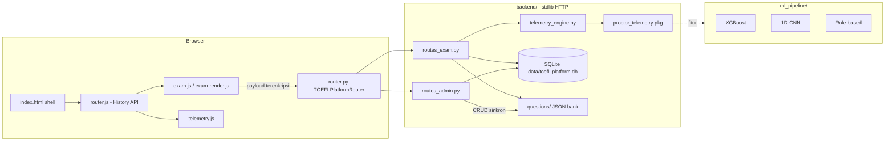

# LinguaPulse TOEFL EPT

<div align="center">


**Platform simulasi TOEFL EPT dengan pengawasan integritas berbasis machine learning.**

Listening · Structure · Reading — plus telemetri perilaku (keystroke dynamics, fokus, pointer) yang dinilai model XGBoost dan 1D-CNN untuk riset integritas pengerjaan.

[Fitur](#-fitur-unggulan) · [Mulai Cepat](#-mulai-cepat) · [Arsitektur](#-arsitektur) · [API](#-ringkasan-api) · [Struktur Proyek](#-struktur-proyek) · [Pengujian](#-pengujian) · [Lisensi](#-lisensi)

</div>

---

## Tentang Proyek

LinguaPulse adalah aplikasi web lengkap untuk latihan TOEFL EPT sekaligus instrumen riset: setiap sesi ujian merekam pola perilaku peserta secara **lokal dan privasi-sadar** — tanpa menyimpan isi ketikan mentah atau isi clipboard — lalu mengekstraknya menjadi fitur terukur (median dwell time, rasio backspace, entropi spasial pointer, episode kehilangan fokus) untuk diklasifikasikan oleh model integritas pengerjaan.

> Hasil latihan bukan skor atau sertifikat TOEFL resmi.

| | |
|---|---|
| **Backend** | Python standard library murni — `http.server`, `sqlite3`, tanpa framework |
| **Frontend** | SPA Vanilla JavaScript, tanpa bundler, tanpa dependensi eksternal |
| **Database** | SQLite tunggal dengan migrasi aditif yang aman terhadap data lama |
| **Bank Soal** | JSON dua arah sinkron dengan editor admin (`questions/`) |
| **ML Pipeline** | XGBoost, 1D-CNN, dan baseline rule-based (`ml_pipeline/`, `packages/proctor_telemetry/`) |
| **Tema Visual** | *Cobalt Modern* — CSS tokens terpusat, tanpa emoji pada UI |

## Fitur Unggulan

### Ruang Ujian
- **Paket EPT utuh** — Listening (audio sintetis lokal), Structure, dan Reading dalam satu sesi 25 menit.
- **Snapshot bank soal per sesi** — `/api/exam/start` membekukan salinan soal ke database, sehingga pengeditan admin tidak pernah mengubah penilaian sesi yang sedang berjalan.
- **Draf tahan kegagalan** — jawaban, bagian aktif, dan sisa waktu tersimpan di perangkat; refresh tidak mengulang timer; kirim ulang otomatis terlindungi ID percobaan anti-duplikasi.
- **Auto-submit saat waktu habis** dengan jaring penyelamat: jika pengiriman gagal, draf tetap aman untuk dicoba kembali.
- **Latihan bebas** (`/practice`) — soal acak, pembahasan langsung, tanpa timer, tanpa rekaman, tidak menyentuh riwayat ujian.

### Pengawasan Integritas (Proctoring)
- **Sensor tiga kanal** — keystroke dynamics (dwell/flight/interkey, backspace, paste), fokus & visibilitas (blur, tab hidden), dan pointer (heatmap ternormalisasi, entropi spasial antar zona passage/answer/navigation).
- **Aktif hanya saat ujian** — sensor pointer dan ketikan mati total di landing, login, dasbor, latihan, dan panel admin.
- **Muatan terenkripsi** — handshake kunci dan enkripsi paket telemetri (`security.js` ↔ `security.py`), verifikasi tantangan anti-bot, cookie sesi `HttpOnly`.
- **Inferensi ganda** — skor XGBoost, 1D-CNN, dan flag rule-based beserta ablation tersimpan terpisah dari hasil akademik.
- **Panel pengawas** — ringkasan operasional, detail sesi dengan timeline peristiwa dan heatmap, manajemen akun, CRUD bank soal dengan pratinjau peserta, impor/ekspor JSON, unggah audio hingga 8 MB.

### Privasi & Etika Riset
- Tidak ada karakter ketikan mentah, isi clipboard, atau data biometrik yang disimpan.
- Halaman `/privacy` dan `/terms` menjelaskan penggunaan data riset.

## Mulai Cepat

```bash
# 1. Masuk ke folder proyek
cd toefl

# 2. Jalankan server (butuh Python 3.11+)
python app.py

# 3. Buka browser
# http://localhost:8000
```

| Akun demo | Username | Sandi |
|---|---|---|
| Pengawas | `admin` | `admin123` |
| Peserta | `nadia_putri` | `student123` |

### Alur Peserta

```
/  landing  →  /register  →  /dashboard  →  /exam (persiapan + persetujuan)
      →  /exam/session (timer 25 menit, sensor aktif)  →  /results  →  /history
```

### Pemeriksaan Kualitas

```bash
python -m compileall -q backend questions      # sintaks Python
node --check frontend/js/exam.js               # sintaks JavaScript (per berkas)
python tests/test_app.py                       # HTTP + headless browser (butuh playwright)
```

## Arsitektur



**Prinsip penting:**

1. **Snapshot per sesi** — bank soal aktif disalin ke `exam_attempts` saat sesi dimulai; resume dan penilaian memakai salinan yang sama.
2. **Pemisahan data** — hasil akademik (`exam_submissions`) dan telemetri (`telemetry_sessions`) berada di tabel berbeda sesuai batasan masalah penelitian.
3. **Kerangka modular** — `TOEFLPlatformRouter` mewarisi `AdminRoutes` + `ExamRoutes`; setiap berkas dibatasi maksimal 350 baris.

## Ringkasan API

| Endpoint | Method | Akses | Fungsi |
|---|---|---|---|
| `/api/auth/login` · `/api/auth/register` · `/api/auth/logout` | POST | Publik | Sesi akun, cookie `HttpOnly` |
| `/api/auth/me` | GET | Publik | Identitas sesi aktif |
| `/api/questions` | GET | Akun | Bank soal publik (admin melihat status aktif) |
| `/api/exam/start` | POST | Peserta | Mulai sesi, bekukan bank, dapat `deadline` |
| `/api/exam/resume` | GET | Peserta | Lanjutkan sesi dari draf perangkat |
| `/api/submit` | POST | Peserta | Kirim jawaban + telemetri terenkripsi |
| `/api/practice/question` | GET/POST | Peserta | Latihan bebas dan pembahasan |
| `/api/history` · `/api/results?id=` | GET | Pemilik | Riwayat dan detail hasil |
| `/api/admin/overview` · `/api/proctor/sessions` | GET | Admin | Ringkasan dan detail pengawasan |
| `/api/admin/questions` (+`/import`, `/export`) | GET/POST/DELETE | Admin | CRUD, impor, ekspor bank soal |
| `/api/admin/audio` | POST | Admin | Unggah audio Listening ≤ 8 MB |
| `/api/admin/users` | GET/POST/DELETE | Admin | Manajemen akun |
| `/api/survey` | GET/POST | Akun | Kuesioner responden riset |

## Struktur Proyek

```
toefl/
├── app.py                      # Entry point: init schema, seed, serve
├── backend/                    # HTTP router + modul domain (semua < 350 baris)
│   ├── router.py               #   SPA routes, API, proteksi origin/CSRF
│   ├── routes_exam.py          #   Submit: penilaian + inferensi telemetri
│   ├── routes_admin.py         #   Handler pengawas
│   ├── attempts.py             #   Snapshot bank per sesi
│   ├── telemetry_engine.py     #   Ekstraksi fitur + fallback engine
│   ├── security.py             #   Handshake, dekripsi, challenge
│   ├── auth.py / sessions.py   #   Akun, hash sandi, cookie HttpOnly
│   └── database.py             #   SQLite + migrasi aditif
├── frontend/
│   ├── index.html              # Shell SPA + fallback tanpa JS
│   ├── pages/                  # Fragmen per route
│   ├── js/                     # router, exam, telemetry, admin, security
│   ├── css/                    # tokens.css (Cobalt Modern) + modul layout
│   └── assets/logo/            # Paket ikon & favicon standar
├── questions/                  # Bank soal JSON per modul
├── packages/proctor_telemetry/ # Engine telemetri: fitur, model, aturan
├── ml_pipeline/                # Evaluasi model klasifikasi integritas
├── tests/                      # HTTP, headless browser, audit halaman
└── docs/qa/                    # Screenshot verifikasi & catatan QA
```

## Pengujian

`python tests/test_app.py` menjalankan uji HTTP dan browser headless memakai database serta berkas soal sementara — tanpa menambah data uji ke database aplikasi. Butuh `playwright` dan Chromium.

```bash
pip install playwright && playwright install chromium
python tests/test_app.py
```

Screenshot QA tersimpan di `docs/qa/` (desktop 1440px, tablet 375px, mobile 320px, termasuk mode full-page).

## Konfigurasi Riset

- **`TOEFL_AI_API_KEY`** — jika diatur, layanan AI menghasilkan umpan balik esai; tanpa kunci, evaluasi lokal dipakai.
- **Turnstile** berjalan mode pengembangan; konfigurasi widget produksi dan HTTPS sebelum deploy publik.
- **Model ML** — prediksi riset bersifat indikatif, bukan penetapan pelanggaran otomatis.

## Lisensi

Proyek ini dilisensikan di bawah [Apache License 2.0](LICENSE).

```
Copyright 2026 LinguaPulse Authors

Licensed under the Apache License, Version 2.0 (the "License");
you may not use this file except in compliance with the License.
You may obtain a copy of the License at

    http://www.apache.org/licenses/LICENSE-2.0
```

<div align="center">

**Dibangun sebagai instrumen riset skripsi — latihan bebas, data terlindungi, hasil jujur.**

</div>
