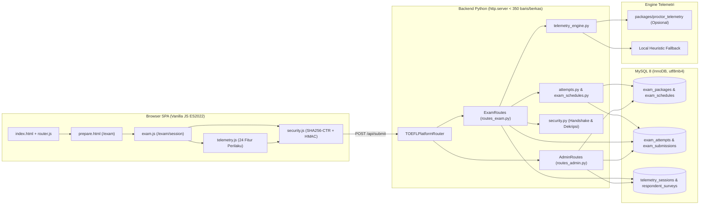

<div align="center">


# LinguaPulse TOEFL EPT

**Platform Simulasi TOEFL EPT & Instrumen Penelitian Telemetri Integritas Pengerjaan**


[Fitur Utama](#fitur-utama) •
[Mulai Cepat](#mulai-cepat) •
[Arsitektur & Alur](#arsitektur--alur-sistem) •
[Referensi API](#referensi-api) •
[Struktur Proyek](#struktur-proyek) •
[Pengujian & QA](#pengujian--pemeriksaan-kualitas) •
[Sitasi Akademik](#sitasi-akademik)

</div>

---

> [!IMPORTANT]
> **Batas Ruang Lingkup & Klaim Riset**
> - **Simulasi Akademik:** LinguaPulse memuat modul pilihan ganda **Listening**, **Structure**, dan **Reading**, disertai tugas **Writing** dan **perbaikan kalimat (rewrite)** sebagai instrumen variasi interaksi penelitian. Hasil latihan **bukan** skor atau sertifikat TOEFL EPT resmi.
> - **Status Model & Heuristik:** Rancangan eksperimen utama penelitian berfokus pada algoritma **XGBoost**. Label skor `xgboost_score`, `cnn1d_score`, dan `rule_flag` pada antarmuka maupun basis data tidak otomatis membuktikan tersedianya model terlatih di dalam repositori ini. Tanpa paket eksternal [`proctor_telemetry`](https://github.com/firdausmntp/proctor_telemetry) beserta artefak model terlatih, `backend/telemetry_engine.py` menjalankan **skor heuristik berbasis koefisien manual** sebagai fallback kompatibilitas.

---

## Tentang Proyek

**LinguaPulse TOEFL EPT** dibangun sebagai platform web simulasi ujian bahasa Inggris sekaligus instrumen pengambilan data perilaku pengerjaan (*work behavior & multimodal telemetry*) untuk penelitian skripsi.

- **Backend:** Python standard library (`http.server.ThreadingHTTPServer`), **PyMySQL**, dan **MySQL 8** (`InnoDB`, `utf8mb4`). Seluruh modul dibatasi maksimal **350 baris per berkas** agar tetap modular dan mudah diaudit.
- **Frontend:** Single Page Application (SPA) berbasis **Vanilla JavaScript (ES2022)** murni tanpa dependensi framework berat, menggunakan History API router dan sistem desain **Cobalt Modern** (`frontend/css/tokens.css`).
- **Sumber Data Tunggal:** MySQL adalah sumber data utama bank soal, paket, jadwal, sesi ujian, dan telemetri. Berkas JSON di `questions/` hanya berfungsi sebagai arsip impor manual; SQLite lama hanya sebagai sumber migrasi satu arah (`scripts/migrate_sqlite_to_mysql.py`).

---

## Fitur Utama

### 1. Manajemen Paket, Jadwal Gelombang, & Akomodasi Peserta
- **Paket Ujian (`/admin/packages`):** Pengawas menyusun paket dengan nama, deskripsi, durasi (`1–240` menit), daftar soal terpilih, dan status draf/publikasi dengan penguncian versi (*optimistic concurrency*). Paket publik wajib memuat minimal soal aktif Listening (dengan audio), Structure pilihan ganda, dan Reading (dengan teks bacaan).
- **Sesi Jadwal & Kode Sesi (`/admin/schedules`):** Pengawas membuat jadwal kelas/gelombang ujian dengan kode sesi unik (mis. `EPT-TERBUKA`), jendela waktu buka–tutup (`opens_at` & `closes_at`), dan kondisi penugasan riset (`MANDIRI`, `COPY_TYPING`, `AI_PARAPHRASE`).
- **Akomodasi Per Peserta (`/api/admin/time-accommodations`):** Mendukung penambahan waktu ekstra (`1–240` menit) dan izin akses **transkrip teks Listening** selama sesi ujian untuk peserta tertentu pada jadwal spesifik.

### 2. Ruang Ujian Terkunci Snapshot & Pemulihan Draf
- **Snapshot Sesi (`exam_attempts`):** Saat peserta memulai sesi di `/exam`, server membekukan salinan bank soal, kunci jawaban, metadata paket, jadwal, akomodasi transkrip, dan tenggat (`deadline`) ke database. Perubahan bank soal oleh admin di tengah jalan tidak merusak penilaian sesi yang sedang berlangsung.
- **Satu Soal per Tampilan (`/exam/session`):** Dilengkapi navigator nomor soal di panel kanan (dapat diciutkan di layar ponsel), penanda soal (*flag for review*), pemutar audio Listening, dan panel bacaan Reading yang mengikuti soal aktif.
- **Ketahanan Draf Lokal:** Jawaban, posisi soal aktif, dan penanda *flag* disimpan di `localStorage` per akun dan percobaan. Muat ulang halaman (*refresh*) mempertahankan tenggat waktu server melalui `/api/exam/resume`.

### 3. Pemisahan Skor Latihan EPT & Tugas Riset
- **Ketepatan Pilihan Ganda:** Hanya modul **Listening**, **Structure**, dan **Reading** yang dihitung dalam persentase ketepatan latihan EPT (`accuracy_percent`).
- **Tugas Tambahan Riset:** Jawaban **Writing (esai)** dan **Structure Rewrite** disimpan sebagai data akademik untuk memperkaya variasi interaksi pengetikan, terpisah dari ketepatan pilihan ganda.
- **Latihan Bebas (`/practice`):** Mode latihan mandiri per modul (termasuk mode latihan dengan transkrip teks Listening) dengan pembahasan langsung, tanpa timer, tanpa perekaman sensor telemetri, dan tanpa menambah riwayat ujian.

### 4. Telemetri Perilaku & Privasi Data
- **Aktivasi Sensor Ketat:** Sensor pointer (`pointerdown`, `pointermove`) dan dinamika ketikan hanya aktif selama peserta berada di ruang ujian aktif (`/exam/session`). Sensor otomatis dimatikan di halaman publik, dasbor, latihan bebas, maupun panel pengawas.
- **Privasi Ketikan & Clipboard:** Sistem **tidak** merekam karakter ketikan mentah (*no raw keylogging*) dan **tidak** membaca isi clipboard. Hanya fitur statistik temporal dan spasial yang diekstraksi (24 fitur, seperti median/IQR *dwell time* & *flight time*, rasio *backspace*, *burst input*, *focus loss*, durasi tab tersembunyi, proporsi zona interaksi, dan entropi spasial Shannon $H$).
- **Pengiriman Terenkripsi:** Payload jawaban dan telemetri dienkripsi di browser dengan skema `SHA256-CTR` serta ditandatangani dengan `HMAC-SHA256` menggunakan kunci sesi dari `/api/security/handshake`.
- **Triase Pengawasan 3 Tingkat (`/admin/proctor`):** Sesi diklasifikasikan ke dalam status triase `TIDAK_TERDETEKSI`, `FLAG`, atau `TERDETEKSI`, lengkap dengan inspeksi fitur ablasi, *heatmap* titik interaksi, linimasa peristiwa, pelabelan *ground truth* pengawas, kuesioner kejujuran responden (`/api/survey`), dan ekspor dataset CSV (`/api/export/csv`).

### 5. Aksesibilitas Antarmuka (Audit WCAG 2.2 AA)
- Mendukung navigasi papan ketik penuh, tautan lewati navigasi (*skip link*), manajemen fokus dialog/drawer dengan latar `inert`, pengumuman *live region* tanpa gangguan setiap detik, kontras warna terverifikasi, serta dukungan `prefers-reduced-motion` dan `forced-colors`. Detail audit terdokumentasi di [docs/accessibility.md](docs/accessibility.md).

---

## Mulai Cepat

### Prasyarat
- **Python 3.11+**
- **MySQL 8.0 / 8.4 LTS** (`InnoDB`, `utf8mb4_bin`)

### 1. Instalasi & Menjalankan Server

```powershell
# 1. Pasang dependensi Python
python -m pip install -r requirements.txt

# 2. Nyalakan MySQL lokal (khusus lingkungan pengembangan Windows/Laragon proyek ini)
./scripts/start_mysql_local.ps1

# 3. Untuk instalasi baru, salin contoh konfigurasi dan sesuaikan kredensial MySQL
# (Jangan timpa berkas .env jika sudah terkonfigurasi di komputer pengembangan ini)
Copy-Item .env.example .env

# 4. Jalankan server aplikasi
python app.py
```

Buka browser di **`http://localhost:8878`**.

### 2. Akun Demo Bawaan

Akun demo dibuat otomatis saat tabel `users` masih kosong pada startup awal:

| Peran | Username | Kata Sandi | Akses Utama |
|---|---|---|---|
| **Pengawas (Admin)** | `admin` | `admin123` | `/admin/overview`, `/admin/proctor`, `/admin/questions`, `/admin/packages`, `/admin/schedules`, `/admin/users` |
| **Peserta (Student)** | `nadia_putri` | `student123` | `/dashboard`, `/practice`, `/exam`, `/exam/session`, `/results`, `/history` |

> [!NOTE]
> Panduan lengkap pembuatan skema MySQL baru, migrasi dari SQLite (`scripts/migrate_sqlite_to_mysql.py`), pengaturan akun uji `.env.test`, serta prosedur `mysqldump` tersedia di **[docs/mysql.md](docs/mysql.md)**.

---

## Arsitektur & Alur Sistem



### Alur Perjalanan Peserta

```text
/ (Beranda & Soal Contoh)
  └──> /login atau /register (Autentikasi Cookie HttpOnly)
        ├──> /practice (Latihan Bebas + Opsi Transkrip Listening, Tanpa Sensor/Timer)
        └──> /dashboard (Ringkasan & Riwayat Singkat)
              └──> /exam (Pilih Paket / Kode Sesi Jadwal + Pilih Prompt Writing + Persetujuan)
                    └──> /exam/session (Snapshot Soal Aktif + Timer Tenggat Server + Sensor Telemetri)
                          └──> /results (Pembahasan Per Seksi + Umpan Balik + Kuesioner Riset)
                                └──> /history (Arsip Hasil Latihan Akun)
```

---

## Referensi API

### Autentikasi & Publik
| Endpoint | Metode | Akses | Deskripsi |
|---|---|---|---|
| `/api/auth/login` · `/api/auth/register` · `/api/auth/logout` | `POST` | Publik | Autentikasi akun dan manajemen sesi cookie `HttpOnly` |
| `/api/auth/me` | `GET` | Publik | Memeriksa identitas sesi pengguna yang sedang aktif |
| `/api/sample-question` | `GET` / `POST` | Publik | Mengambil dan memeriksa soal contoh interaktif di halaman beranda |

### Peserta, Latihan, & Sesi Ujian
| Endpoint | Metode | Akses | Deskripsi |
|---|---|---|---|
| `/api/practice/question` | `GET` / `POST` | Peserta | Mengambil soal latihan bebas (mendukung filter `?transcript=1`) dan mengecek jawaban |
| `/api/exam/packages` | `GET` | Akun | Daftar paket ujian publik atau pratinjau struktur paket (`?id=`) tanpa kunci jawaban |
| `/api/exam/schedules` | `GET` | Akun | Daftar sesi jadwal aktif beserta status jendela waktu dan akomodasi peserta |
| `/api/security/handshake` | `GET` | Akun | Menginisiasi sesi kriptografi (`handshake_id`, `session_key`, konfigurasi Turnstile) |
| `/api/exam/start` | `POST` | Peserta | Memulai percobaan ujian, membekukan snapshot bank soal, dan menghitung `deadline` |
| `/api/exam/resume` | `GET` | Peserta | Melanjutkan sesi ujian aktif berdasarkan `attempt_id` |
| `/api/submit` | `POST` | Peserta | Mengirim jawaban + payload telemetri terenkripsi dalam satu transaksi atomik |
| `/api/results` · `/api/history` | `GET` | Pemilik | Mengambil detail pembahasan sesi (`?id=`) dan daftar riwayat latihan peserta |
| `/api/survey` | `GET` / `POST` | Akun | Mengambil atau mengirim kuesioner kejujuran responden pascaujian |

### Panel Pengawas (Admin)
| Endpoint | Metode | Akses | Deskripsi |
|---|---|---|---|
| `/api/admin/overview` | `GET` | Admin | Ringkasan metrik operasional platform, distribusi modul, dan sesi terbaru |
| `/api/proctor/sessions` | `GET` | Admin | Daftar sesi telemetri lengkap dengan fitur, skor ablasi, *heatmap*, linimasa, dan triase |
| `/api/proctor/label` | `POST` | Admin | Memperbarui label *ground truth* pengawas pada sesi telemetri |
| `/api/export/csv` | `GET` | Admin | Mengunduh dataset telemetri multimodal (36 kolom fitur & metadata) dalam format CSV |
| `/api/admin/questions` | `GET` / `POST` / `DELETE` | Admin | CRUD butir soal (Listening, Structure, Rewrite, Reading, Writing) |
| `/api/admin/questions/import` · `/export` | `POST` / `GET` | Admin | Impor dan ekspor bank soal dalam format JSON |
| `/api/admin/audio` | `POST` | Admin | Unggah berkas audio Listening (`.mp3`, `.wav`, `.ogg`, `.m4a`, maks. 8 MB) |
| `/api/admin/packages` | `GET` / `POST` | Admin | Mengelola konfigurasi paket ujian, urutan soal, dan status publikasi |
| `/api/admin/schedules` | `GET` / `POST` / `DELETE` | Admin | Mengelola sesi jadwal gelombang ujian, kode sesi, dan waktu buka/tutup |
| `/api/admin/time-accommodations` | `GET` / `POST` | Admin | Mengatur tambahan waktu ujian dan izin transkrip Listening per peserta pada jadwal |
| `/api/admin/users` | `GET` / `POST` / `DELETE` | Admin | Manajemen akun peserta dan pengawas |

---

## Struktur Proyek

```text
APLIKASI/
├── app.py                          # Entry point server: init schema, seed akun demo, HTTP server
├── AGENTS.md                       # Pedoman arsitektur, batas 350 baris/berkas, & aturan narasi riset
├── design.md                       # Spesifikasi sistem desain Cobalt Modern
├── requirements.txt                # Dependensi runtime Python (PyMySQL, python-dotenv)
├── backend/                        # Modul backend modular (seluruh berkas < 350 baris)
│   ├── router.py                   # TOEFLPlatformRouter: routing SPA, API, proteksi Origin/CSRF
│   ├── routes_exam.py              # Penilaian ujian, transaksi submit atomik, & pencatatan telemetri
│   ├── routes_admin.py             # Endpoint pengawasan, CRUD soal, jadwal, akomodasi, & ekspor CSV
│   ├── attempts.py                 # Pembekuan snapshot bank soal & jadwal per sesi ujian
│   ├── exam_packages.py            # Validasi kesiapan & pengelolaan paket ujian
│   ├── exam_schedules.py           # Jadwal gelombang ujian, kode sesi, & klasifikasi triase 3 tingkat
│   ├── exam_accommodations.py      # Akomodasi tambahan waktu & transkrip Listening per peserta
│   ├── question_store.py           # Penyimpanan soal relasional, impor/ekspor JSON
│   ├── audio_upload.py             # Validasi & penyimpanan unggahan audio Listening
│   ├── telemetry_engine.py         # Jembatan ke paket proctor_telemetry & fallback heuristik lokal
│   ├── security.py                 # Handshake kriptografi, SHA256-CTR, HMAC-SHA256, & Turnstile
│   ├── auth.py / sessions.py       # Hash sandi PBKDF2-HMAC-SHA256 & sesi cookie HttpOnly
│   ├── database.py                 # Context manager koneksi MySQL (commit/rollback deterministik)
│   ├── mysql_schema.py             # Definisi tabel InnoDB & migrasi skema otomatis
│   └── legacy/                     # Referensi tekstual migrasi SQLite lama (tidak dieksekusi)
├── frontend/
│   ├── index.html                  # Shell utama SPA
│   ├── pages/                      # Fragmen HTML per rute (landing, auth, dashboard, prepare, exam, dll.)
│   ├── js/                         # Modul JavaScript per domain fitur
│   │   ├── core/                   # router.js, state.js, accessibility.js, form-errors.js, icons.js
│   │   ├── exam/                   # exam.js, exam-render.js, exam-packages.js, telemetry.js, security.js
│   │   ├── admin/                  # Panel admin, paket, jadwal, akomodasi, akun, combobox, & editor soal
│   │   ├── account/                # Autentikasi masuk/daftar
│   │   └── learning/               # Landing, dasbor peserta, latihan bebas, hasil, & riwayat
│   ├── css/                        # Stylesheet modular berbasis tokens.css & accessibility.css
│   └── assets/                     # Paket SVG logo geometris (viewBox 0 0 256 256) & pratinjau UI
├── questions/                      # Loader bank soal MySQL & arsip JSON per seksi
├── packages/                       # (Gitignored) Lokasi opsional paket eksternal proctor_telemetry
├── ml_pipeline/                    # Skrip inspeksi & evaluasi ringkasan dataset telemetri
├── scripts/                        # Utilitas start MySQL lokal, migrasi SQLite->MySQL, & generator audio
├── tests/                          # Suite pengujian unit, integrasi MySQL sementara, & Playwright E2E
└── docs/                           # Dokumentasi MySQL (mysql.md), Aksesibilitas (accessibility.md), & QA
```

### Integrasi Opsional `packages/proctor_telemetry`

Direktori `packages/` sengaja diabaikan oleh `.gitignore` karena berisi repositori terpisah ([`proctor_telemetry`](https://github.com/firdausmntp/proctor_telemetry)). Jika ingin menautkan paket engine eksternal tersebut:

```powershell
git clone https://github.com/firdausmntp/proctor_telemetry.git packages/proctor_telemetry
```

Tanpa direktori tersebut, `backend/telemetry_engine.py` otomatis beralih ke fallback ekstraksi fitur dan fungsi heuristik lokal sehingga seluruh alur aplikasi dan pengujian tetap berjalan penuh.

---

## Pengujian & Pemeriksaan Kualitas

Seluruh pengujian database menggunakan `tests/mysql_support.py` dan konfigurasi `.env.test` yang membuat serta menghapus skema sementara `linguapulse_test_*` secara otomatis, sehingga **tidak pernah mengotori database aplikasi utama**.

```powershell
# 1. Pemeriksaan kompilasi sintaks Python
python -m compileall -q backend questions tests

# 2. Jalankan seluruh unit & integration test (skema MySQL sementara)
python -m unittest discover -s tests -p "test_*.py" -v

# 3. Uji paket, jadwal, akomodasi, & alur kerja aksesibel (Playwright Chromium)
python tests/package_checks.py
python tests/test_exam_schedules.py
python tests/test_accessible_workflow.py

# 4. Uji E2E penuh HTTP & browser headless + audit WCAG 2.2 AA
python tests/test_app.py
python tests/accessibility_audit.py --ui-only
```

---

## Catatan Konfigurasi Riset

- **`TOEFL_AI_API_KEY`:** Jika disetel pada environment, modul `backend/ai_tutor.py` meminta umpan balik esai/struktur ke layanan AI eksternal; jika kosong, evaluasi berbasis aturan lokal digunakan secara deterministik.
- **Cloudflare Turnstile:** Saat pengembangan lokal, verifikasi menggunakan kunci uji dummy dan mode simulasi. Sebelum deployment publik, widget produksi Turnstile, verifikasi token penuh (`CF_ENFORCE_STRICT=true`), dan HTTPS wajib diaktifkan.

---

## Sitasi Akademik

Apabila platform ini, skema telemetri perilaku pengerjaannya, atau arsitektur pengawasannya dirujuk dalam skripsi, tesis, makalah, maupun publikasi ilmiah, silakan gunakan sitasi berikut:

```bibtex
@software{utomo2026linguapulse,
  author       = {Utomo, Firdaus Satrio},
  title        = {LinguaPulse TOEFL EPT: Web-Based TOEFL EPT Simulation Platform with Machine Learning-Based Work Integrity Telemetry},
  year         = {2026},
  publisher    = {GitHub},
  journal      = {GitHub repository},
  howpublished = {\url{https://github.com/firdausmntp/LinguaPulse}},
  note         = {Telemetry engine: ProctorTelemetry (\url{https://github.com/firdausmntp/proctor_telemetry})}
}
```

---

## Lisensi

Didistribusikan di bawah lisensi **[Apache License 2.0](LICENSE)**.

<div align="center">

**LinguaPulse TOEFL EPT** — *Instrumen Riset Skripsi • Latihan Terstruktur • Privasi Terjaga • Evaluasi Jujur*

</div>
